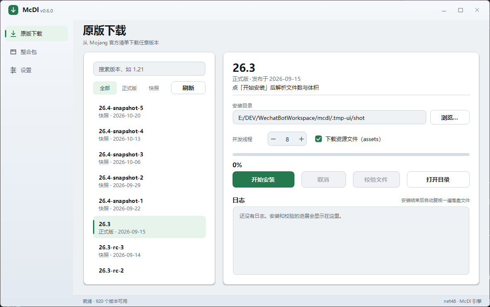
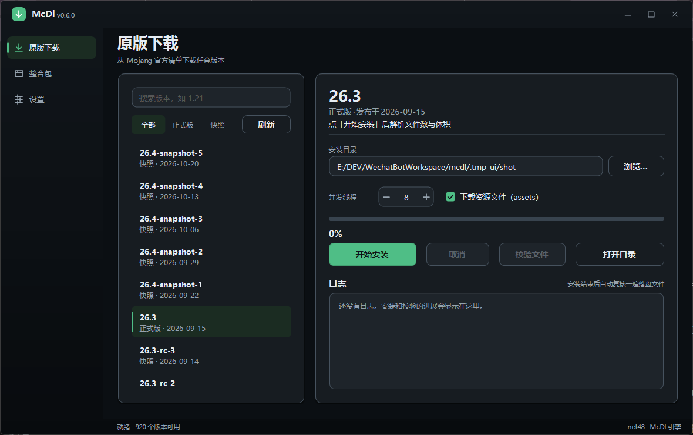

# McDl

[](https://github.com/Ranecc/McDl)
[](LICENSE)


[](https://github.com/Ranecc/McDl/actions/workflows/ci.yml)
[](https://github.com/Ranecc/McDl/releases)
[](https://github.com/Ranecc/McDl/releases)

McDl 是面向 Windows 的 Minecraft 游戏文件下载器。

McDl 把某个版本或某个整合包运行所需的文件——客户端 jar、libraries、natives、资源索引与 assets——写入指定的 `.minecraft` 目录，产出可被 HMCL、PCL2、官方启动器等直接使用的游戏本体。账号登录、版本隔离与游戏启动由启动器负责，不属于 McDl 的职责。

本项目的直接背景：2026 年 10 月 20 日，PCL2 自 2.99.0.0 起移除内置下载功能，同日国内数个第三方启动器亦相继下线下载服务。此后补一份干净的游戏文件，需要使用者自行获取版本清单、库文件、资源索引与各类镜像地址。McDl 将这一流程收敛为单个可执行文件。

## 支持范围

**游戏版本。** Mojang 公开发布的任意版本，含正式版、快照与早期版本。

**整合包格式。** Modrinth 的 `.mrpack`、CurseForge 与 HMCL 导出的 `manifest.json`、MCBBS 的 `mcbbs.packmeta`、HMCL 的 `modpack.json`，以及纯原版包。McDl 安装整合包的游戏本体与加载器；包内的模组、配置文件、资源包与光影不在下载范围内，其清单记录仅用于识别所需版本与加载器。

**加载器。** Fabric 的库列表取自官方 meta；Forge 与 NeoForge 下载官方 installer，并以本机 Java 执行 `--installClient`。Quilt 不受支持，检测到 Quilt 整合包时将明确告知，不做兼容性尝试。

**平台。** 本版本基于 WinForms 与 .NET Framework 4.8，仅支持 Windows 10、11；Linux 与 macOS 暂不在计划内。

## 图形界面

Windows 10/11 直接双击 `McDl.exe` 运行，无需预装 .NET。exe 约 415 KB，核心库与 JSON 库已嵌入其中。

窗口左侧是导航，分三页：

- **原版下载**：从 Mojang 官方清单拉版本列表，可搜索，也可按正式版/快照过滤；右边是安装面板，安装目录首次默认为 `%APPDATA%\.minecraft`，可以改。
- **整合包**：把 `.mrpack`、`.zip`、`.hmcl` 拖进窗口，或点「选择整合包…」；先显示识别出的格式、Minecraft 版本和加载器，再决定装到哪。
- **设置**：配色（跟随系统、浅色、深色）、默认安装目录、默认并发线程、是否下载 assets。

同一套界面的浅色与深色主题：





标题栏可拖动，双击最大化，四边和四角都能改大小。界面的设计与自绘控件细节见 [docs/ui.md](docs/ui.md)。

assets 复选框记住上次选择，首次运行时默认不勾选：完整资源约占总下载量的九成，不勾选时仅下载客户端、库与 natives。不勾选不影响游戏本体安装，但游戏内将缺少声音与语言文件。

安装结束后会自动复核一遍落盘的文件：逐个比对大小与 SHA1，列出缺失或内容不符的项。这防的是下载完成之后被改——杀毒软件隔离、磁盘问题、事后被替换。失败只提示，**不删除、不改写任何文件**；重跑安装即可补齐，干净的文件会跳过。解析出安装计划之后，「校验文件」按钮可用（在「打开目录」左边），可随时手动复查；校验期间可以点「取消」，只中止，不动文件。详见 [docs/verification.md](docs/verification.md)。

## 命令行

命令行版本位于 `src\McDl.Cli`，编译产物为 `mcdl.exe`，未包含在发布 zip 中，需自行构建：

```powershell
dotnet build src\McDl.Cli\McDl.Cli.csproj -c Release
.\src\McDl.Cli\bin\Release\net48\mcdl.exe list --limit 3
```

以下示例中的 `mcdl` 均指该 exe；如需直接使用，请将其所在目录加入 `PATH`。

```
versions: 920

26.4-snapshot-5    snapshot   2026-10-20T12:15:06+00:00
26.4-snapshot-4    snapshot   2026-10-13T12:05:46+00:00
26.4-snapshot-3    snapshot   2026-10-06T12:54:26+00:00
```

安装前可用 `plan` 查看将下载的内容规模：

```powershell
mcdl plan 1.20.1
```

```
name         : 1.20.1
version      : 1.20.1
asset index  : 5
root         : <安装目录>\.minecraft
files        : 3649
size         : 699.1 MB

  Assets     3598 files    621.5 MB
  Maven        50 files     55.6 MB
  Meta          1 files     22.0 MB

natives to unpack:
  lwjgl-glfw-3.3.1-natives-windows.jar
  ...
```

`plan` 只解析版本元数据并打印结果，不执行下载；但该过程会将版本 JSON 与资源索引写入目标目录，因此不应在正在使用的 `.minecraft` 上执行。

正式安装：

```powershell
mcdl install 1.20.1 --root D:\Games\.minecraft --threads 8
mcdl install latest-snapshot --no-assets
mcdl modpack .\某个整合包.mrpack --root D:\Games\.minecraft
```

`install` 先打印计划，随后以单行刷新的进度条显示过程，结束时汇总下载数、已存在数与失败数。过程中可按 Ctrl+C 取消；重新执行时，SHA1 校验通过的文件直接跳过，未完成的文件自 `.part` 续传。

装完之后可以单独复核磁盘上的文件，不下载任何内容：

```powershell
mcdl verify 1.20.1 --root D:\Games\.minecraft
```

```
verifying ...
校验 3649 个文件：全部一致
```

有文件缺失或内容不符时逐条列出并返回退出码 2（0 表示干净，1 表示用法或解析错误），只报告不删除。`--root` 在 `verify` 下必填。完整命令与参数见 [docs/cli.md](docs/cli.md)，校验的语义与边界见 [docs/verification.md](docs/verification.md)。

## 目录结构

以 `install --root D:\Games\.minecraft` 为例：

```
D:\Games\.minecraft\
  versions\1.20.1\1.20.1.json            版本配置
  versions\1.20.1\1.20.1.jar             客户端 jar
  libraries\...                          库文件，按 Maven 目录排布
  assets\indexes\5.json                  资源索引
  assets\objects\ab\abcdef...            资源本体，按 SHA1 前缀分目录
  assets\virtual\5\...                   1.7 以前版本的虚拟资源目录
  resources\...                          更早版本的扁平资源目录
  .mcdl\installers\...                   Forge / NeoForge 官方 installer
  versions\<整合包名>\<整合包名>.json     整合包装配后的启动配置，继承加载器版本
```

除上述内容外，游戏目录中不会产生其他文件。`.mcdl` 为 McDl 的工作目录，删除后不影响已安装版本，下次安装 Forge 时 installer 会重新下载。

图形界面把安装目录、线程数、assets 勾选与配色记在 `%APPDATA%\McDl\settings.json`，不写进游戏目录；命令行不读写这份设置。

## 运行环境

Windows 10 或 11。Win10 1903 起系统自带 .NET Framework 4.8，无需单独安装运行时。

Java 仅在安装 Forge、NeoForge 时需要；原版下载与 Fabric 安装不涉及 Java。所需 Java 版本优先取自 Mojang 版本元数据，元数据缺失时按下表兜底：

| Minecraft | Java |
| --- | --- |
| 1.20.5 及以后 | 21 |
| 1.18 – 1.20.4 | 17 |
| 1.17 | 16 |
| 1.16.5 及更早 | 8 |

McDl 依次在 `JAVA_HOME`、`PATH`、注册表 JavaSoft / Adoptium 项、`Program Files` 下的 `Java`、`Eclipse Adoptium`、`Microsoft` 子目录，以及官方启动器下发的 `runtime` 中查找 `java.exe`，并对每个候选实际执行 `java -version` 核验版本，而非仅依据路径判断。选择策略：优先主版本号与要求精确匹配者；无匹配时退而取高于要求中版本最低者——部分旧版 Forge installer 仅接受其对应时代的 Java。全部候选均不可用时，报错信息会指明所需版本，例如：

```
Forge 的 installer 需要 Java 17 或更高版本，但本机未找到可用的 java.exe。
可安装 JDK 17+，或将 java.exe 所在目录加入 PATH 后重试。
```

## 镜像与代理

每个下载请求带有类别标记：版本元数据（Meta）、Maven 库（Maven）、资源文件（Assets）、其他直链（Other）。Meta、Maven、Assets 优先请求官方源，失败后切换 BMCLAPI。某条线路失败一次，其在后续请求中的优先级即下降；成功一次后恢复。整合包内直链与 Fabric meta 属于 Other 类别，不走镜像。

程序不设独立代理配置，HTTP 请求遵循 Windows 系统代理。

## 验证发布包

每个 release 附 `SHA256SUMS`、`McDl-<版本>.exe.sha256`、`BUILD-INFO.txt` 与 `sbom.json`，`SHA256SUMS` 另有一份 cosign keyless 签名（`SHA256SUMS.sig` 与 `SHA256SUMS.pem`）。先验签，再对哈希，命令可直接复制，见 [docs/verifying-releases.md](docs/verifying-releases.md)。发现安全问题请走私密报告，方式见 [SECURITY.md](SECURITY.md)。

## 它会访问哪些地址、写哪些文件

只连 Minecraft 官方域名与 BMCLAPI 镜像，不访问 GitHub API，没有遥测，也没有自动更新检查。安装只写目标目录，图形界面的设置写在 `%APPDATA%\McDl\settings.json`，不写注册表，不落日志文件。完整域名清单、目录布局，以及 Forge / NeoForge installer 会自己联网这件事，见 [docs/network-and-files.md](docs/network-and-files.md)。

## 常见问题

**下载缓慢或连不上官方源。** 先观察日志中线路是否已切换至 BMCLAPI。两条线路均慢，一般为本机网络问题；启用代理时检查系统代理是否实际生效。Fabric meta 为直连，不受镜像影响。

**下载中断。** 重新执行安装即可。已完整文件按 SHA1 跳过，未完成文件自 `.part` 续传。

**单个文件校验失败。** 先重试；仍失败则删除该文件后重跑。命令行会报告首个失败文件及原因。SHA1 不符通常意味着链路上存在返回错误页面的代理或镜像。

**装完之后启动器提示文件损坏，或是文件被改了。** 用 `mcdl verify`（图形界面为「校验文件」按钮）复核一遍磁盘：它比对大小与 SHA1，只报告不符与缺失的项，不删除文件。随后重跑 `install` 补齐——已正确的文件会跳过。若同一处反复不符，先查杀毒软件的隔离记录和磁盘状态，不要反复重装。详见 [docs/verification.md](docs/verification.md)。

**Forge / NeoForge installer 中途退出或超时。** installer 运行上限 10 分钟，超时强制结束。先查日志中 installer 的最后 20 行，常见原因为 Java 版本不符、目录无写权限、下载处理器网络受阻。修正后重跑，已下载文件不会重复下载。

**installer 自行退出，日志仅数行，`versions` 目录无新增。** Forge 官方 installer 内部直连 `launchermeta.mojang.com`、`libraries.minecraft.net` 等域名，不经过 McDl 的镜像体系。若这些域名在本机网络中被代理、hosts 或加速工具干扰，installer 会静默失败且退出码为 0。放通上述域名或启用系统代理后重试。McDl 会核验 `versions` 下是否实际生成目录，未生成即按失败上报。

**装完能否直接启动。** McDl 不承担启动职能。以 HMCL、PCL2 或官方启动器打开该 `.minecraft` 即可，Forge / NeoForge / Fabric 的版本配置已写入。整合包内模组需由启动器另行获取。

**为什么不登录、不做正版校验。** 理由不是懒得做，而是四件事各自都不划算。

下载本身不需要身份。客户端 jar、库、资源索引与 assets 都是 Mojang 公开托管的，任何人不带账号也能取到。登录对下载没有帮助，只会让 McDl 拿到它不该持有的东西——密码以外的 token 同样属于凭证。

其次，接登录不是加一个按钮。要做微软账号授权，得在 Azure 注册应用、处理 OAuth 回调与 refresh token 轮换，还要持续跟上 Minecraft 第三方客户端的使用条款。这些是长期义务：应用要维护、条款会变、出错得有人响应。本项目没有服务端，也没有专职维护者，接不起这份义务。

第三，处理 token 会把整个安全面抬高一档。代码路径一旦要接收、刷新、保存凭证，就多出若干端点、存储与失效处理；要让别人信得过这些代码，得有安全审阅乃至渗透测试的预算。本项目没有，SECURITY.md 里也写明只尽力而为、没有 SLA。在这种条件下承诺「替你保管微软账号」是不负责任的说法。所以这里的取舍很明确：不碰凭证，也不读取其它启动器保存的账号文件。

最后，正版校验不带来任何能力。判定「是否正版」确实必须拿 token 去问 Mojang，但 McDl 下载的是没有 DRM 的公开文件，装完之后能不能进服务器、以什么身份进，由启动器与服务端（online-mode）决定。在本工具里加一道正版校验，只是平白多一条需要保管凭证的路径，不会让下载更正确；`verify` 比对的是公开文件的哈希，与「是否是正版」无关。

这是当前的选择：不做账号。将来若有人接手 OAuth 与安全响应，可以作为独立模块加入，前提是不影响「不登录也能下载」这条主线。使用前提与责任边界见[免责声明](#免责声明)。

**exe 为何仅三百余 KB。** 目标框架为 net48，运行时使用系统自带组件；Core 与 Newtonsoft.Json 经 Costura 嵌入 exe。若改为自带运行时的 .NET 8 单文件发布，体积在数十 MB 量级。

**安装至 `Program Files` 失败。** 权限不足，改用普通用户目录，或以管理员身份运行。

**日志文件。** 图形界面日志仅保留当次运行，不写文件。需要留存输出时使用命令行，可重定向保存。

## 构建与测试

环境要求：Windows 10 / 11，.NET SDK 10.0.301（`global.json` 以 `rollForward: disable` 钉死这一版本，补丁版不同构建出的字节就不同），PowerShell 7。完整步骤见 [BUILDING.md](BUILDING.md)。

```powershell
dotnet restore mcdl.sln --locked-mode
dotnet build mcdl.sln -c Release
pwsh -NoProfile -File tools\test.ps1
pwsh -NoProfile -File tools\build-release.ps1 -Version 0.4.0
```

`tools\test.ps1` 经 xunit.console 直接运行 net48 测试程序集；勿用 `dotnet test`，缘由见 [docs/testing.md](docs/testing.md)。

发布脚本在 `dist\` 下产出两个包：`McDl-<版本>-win.zip` 是单文件版，`McDl-<版本>-win-unbundled.zip` 把 `McDl.Core.dll` 与 `Newtonsoft.Json.dll` 放在 exe 旁边。同时生成 `SHA256SUMS`、`BUILD-INFO.txt`、`RELEASE-NOTES.md`、`sbom.json`，以及单独的 `McDl-<版本>.exe` 与它的 `.sha256`。两个 zip 里都不放 PDB。

### 依赖

| 依赖 | 用途 |
| --- | --- |
| Newtonsoft.Json | 解析 Mojang 版本元数据、整合包与 Fabric meta 的 JSON |
| Costura.Fody | 构建时把托管依赖嵌进单文件 exe |
| Microsoft.SourceLink.GitHub | 把仓库地址与提交信息写进程序集和 PDB |
| xunit（含 xunit.runner.console） | 测试，由 `tools\test.ps1` 运行 |

具体版本以各项目旁的 `packages.lock.json` 为准，`dotnet restore --locked-mode` 按锁文件还原，不跟随浮动版本。

### 可复现构建

同一 SDK、同一提交，两个不同目录 clean build 得到的 `McDl.exe` 逐字节一致（已实测，打包脚本产出的 exe 与两个 zip 也一致）。SDK 补丁版必须一致，否则字节会变；CI 与本机在同一 SDK 下的比对还没有结论。现状与验证方法见 [docs/reproducible-builds.md](docs/reproducible-builds.md)。

修改代码前请先阅读 [docs/contributing.md](docs/contributing.md)；内部分层见 [docs/architecture.md](docs/architecture.md)。

## 免责声明

**工具属性。** McDl 是正版辅助工具，用途是替已经拥有 Minecraft: Java Edition 正版授权的玩家，把 Mojang 官方发布的游戏文件从官方 CDN（或其公开镜像）取回本地并做完整性校验。它不提供游戏，不破解，不分发游戏本体，也不绕过任何授权机制。

**不涉及中国版。** Minecraft 在中国大陆由网易独家代理运营。本工具只面向 Mojang 国际版公开托管的文件，不提供、不内置、不聚合任何中国版（网易版）内容，也不提供任何绕开地区限制或授权校验的办法。

**它不校验授权。** 本工具不登录、不校验正版，缘由见上文「为什么不登录、不做正版校验」；因此是否具备合法授权只能由使用者自行判断。请在持有正版授权的前提下使用，未持有正版授权者不应使用本工具获取游戏文件。

**责任归属。** 使用者应自行遵守 Minecraft 使用条款（EULA）、微软服务协议以及所在地法律。因违规使用、二次分发或商业利用本工具引发的争议与损失，由使用者自行承担，作者与本项目不承担相关责任。

**透明与可验证。** 只访问 [docs/network-and-files.md](docs/network-and-files.md) 列出的公开端点；Forge / NeoForge 的官方 installer 由本地 Java 运行，它自己还会访问 Mojang 的官方域名（launchermeta、libraries 等），这部分行为不在本工具控制范围内。下载的每个文件以官方元数据里的 SHA1 为准逐个校验，官方 CDN 优先、镜像兜底，不一致就报错而不是静默接受——落盘之后还有一次全量复核，见 [docs/verification.md](docs/verification.md)。发布产物附 `SHA256SUMS` 与 cosign keyless 签名（证明字节没被替换），并附 `sbom.json` 与可复现构建的比对方法（见 [docs/reproducible-builds.md](docs/reproducible-builds.md)）——你可以按同一套命令自行重建并比对哈希，确认产物就是这份源码构建出来的。

**无担保。** 本项目按「现状」提供，不承诺可用性、适用性，也不承诺没有缺陷。

## License

MIT，见 [LICENSE](LICENSE)。

代码为本项目独立实现，行为依据 Mojang 公开协议文档、Modrinth / CurseForge / MCBBS / HMCL 的公开包格式说明及各加载器的官方 API。本项目以 MIT 发布，与采用其他许可的既有下载器之间不存在代码来源关系。
